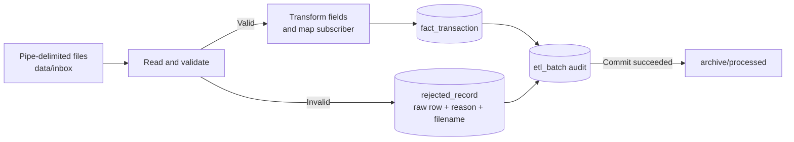

# Telecom Data Warehouse ETL


A complete, runnable ETL project for the telecom transaction case study. It ingests the supplied pipe-delimited files, validates and transforms each record, writes accepted transactions and rejects to separate destinations, tracks each batch, and archives a source file only after its database transaction commits.

The local demonstration uses Python's standard library and SQLite, so it runs without an ETL platform or database server. SQL Server DDL and lookup seed scripts are included for the target model in the original materials. The SQL Server scripts describe the production-shaped schema; the Python runner currently writes to SQLite.

## Contents

```text
src/telecom_etl/                 ETL pipeline and CLI
sql/seed_imsi_reference.sql      SQLite demo lookup seed
sql/sqlserver/                   SQL Server schema and lookup seed
data/samples/                    Source CSV samples supplied with the case
data/inbox/                      Drop new input files here
data/archive/processed/           Successfully loaded files
data/archive/failed/              Reserved for operational quarantine
```

## ETL flow



Each input file is processed as a database transaction. Valid rows, rejected rows, and the batch audit record commit together. If processing fails, the transaction rolls back and the file remains in the inbox for a later retry. Rejected rows retain the original values as JSON, the source filename, row number, and a readable rejection reason.

## Case rules implemented

| Input | Transformation / validation | Outcome |
|---|---|---|
| `id` | Parse as an integer | Reject if empty or not an integer |
| `imsi` | Preserve the source value; map subscriber through the 9-character IMSI reference prefix | Reject if empty; use subscriber ID `-99999` when unmapped |
| `imei` | Derive TAC from the first 8 and SNR from the last 6 characters | Set TAC and SNR to `-99999` when IMEI is empty or shorter than 14 characters; preserve the IMEI source value (or `-99999` when empty) |
| `cell`, `lac` | Parse as integers | Reject if empty or not an integer |
| `event_type` | Preserve a single character; empty values become SQL `NULL` | Reject values longer than one character |
| `event_ts` | Parse supported day-first, month-first, and ISO datetime formats and store in ISO form | Reject if empty or invalid |

The PDF describes a 9-character IMSI while most supplied batch rows contain a full 15-character IMSI. To retain source data and use the supplied lookup table, the pipeline joins by the first 9 characters. The source files are pipe-delimited (`|`), and the reader uses that delimiter.

## Requirements

- Python 3.10 or newer
- No third-party Python packages for the SQLite demonstration

## Run locally

From the repository root, create a virtual environment if desired, then copy a sample file into the inbox and run the loader:

### Windows PowerShell

```powershell
Copy-Item .\data\samples\03_sample_data.csv .\data\inbox\
$env:PYTHONPATH = "src"
python -m telecom_etl --root .
```

### macOS / Linux

```bash
cp data/samples/03_sample_data.csv data/inbox/
PYTHONPATH=src python -m telecom_etl --root .
```
No package installation or third-party library is needed for these commands. After the run:

- `data/telecom_dwh.sqlite3` contains the demo warehouse tables.
- `data/archive/processed/` contains successfully processed files.
- Query `fact_transaction`, `rejected_record`, `dim_imsi_reference`, and `etl_batch` in SQLite to review the results.

To continuously poll for files every five minutes:

```bash
python -m telecom_etl --root . --watch
```

Use `--interval 30` for a 30-second polling interval during a local demonstration. Stop watch mode with `Ctrl+C`.

## Database tables

- `dim_imsi_reference`: IMSI prefix to subscriber ID mapping, seeded from the supplied case-study SQL.
- `fact_transaction`: validated and transformed transactions plus source lineage.
- `rejected_record`: rejected source rows, filename, line number, and reason.
- `etl_batch`: one audit row per successfully processed source filename, with valid/rejected counts.

The SQLite database is created on first run. To use SQL Server Management Studio for the schema, execute `sql/sqlserver/01_schema.sql`, followed by `sql/sqlserver/02_seed_imsi_reference.sql`. SQL Server execution is provided as a schema/reference setup; a SQL Server-connected Python adapter or SSIS package is not part of this runner.

## Configuration and operations

The inbox is `data/inbox/`. Only `*.csv` files are read. Successfully committed files are moved to `data/archive/processed/`; failures are logged and the original file is left in the inbox for retry. The database is deliberately ignored by Git, and inbox/archive CSV files are ignored to avoid publishing live customer data accidentally. The supplied case samples under `data/samples/` are included for reproducibility.

Avoid placing real customer data in this repository. For production, add a secure secret store, database credentials, retention policy, monitoring, and a SQL Server destination adapter before deployment.

## Repository resources

- [Telecom ETL project tutorial](https://www.youtube.com/watch?v=ZNAX6LwoTDY&list=PLcAbhg_RWLaLUaYpAAvOLu2hlyVgZlRjb)
- [Upload a project to GitHub](https://www.youtube.com/watch?v=w3_RCT0O1oM)
- [Professional README tutorial](https://www.youtube.com/watch?v=evz1LqEomTE)
- [Additional README tutorial](https://www.youtube.com/watch?v=pHllKT62-rc)

## License

MIT. See [LICENSE](LICENSE).
